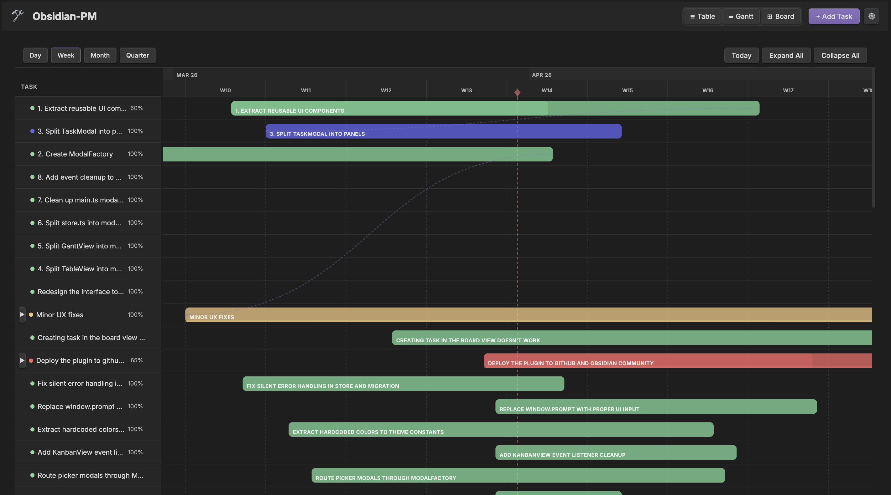
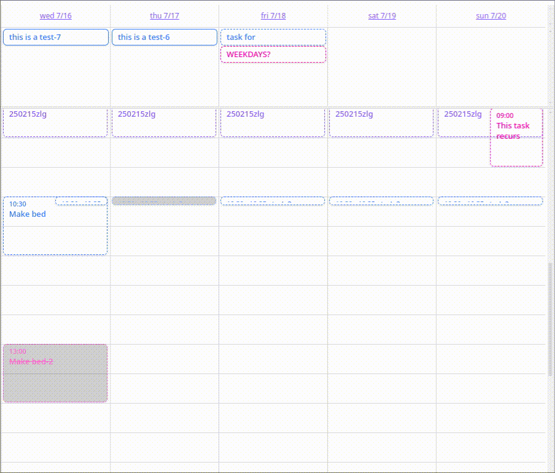

# Project Engineering Handbook

Practical skills for planning, building, and leading projects.

Each skill is standalone. Each starts with a short exercise and produces a real artifact. Use the whole system or take only the parts you need.

This repo was *vibecoded*. It is one person’s personal workflow, not a prescribed system. Nothing here is dictated. It is a platform for you to learn from, remix, and take into your own adventures.

## Start here

### 1. Access the handbook

**Read in your browser (no install).** You are already here. Use the file list or the links on each page, starting with [START-HERE.md](START-HERE.md). Markdown renders on GitHub. Links written as `[[Note]]` appear inside `templates/` and only work when that folder is open in Obsidian. Folders that start with a dot are editor settings; ignore them while reading.

**Read and work in Obsidian.**

1. Install Obsidian from <https://obsidian.md> (1.13 or newer for the templates).
2. Get the repo: `git clone https://github.com/openrodygu/project-engineering.git`, or choose **Code → Download ZIP** and extract it.
3. In Obsidian, choose **Open folder as vault** and select the repo folder. That gives you the handbook with working links and search.
4. To use a template, copy `templates/team-vault/` or `templates/personal-vault/` to another folder and open the copy as its own vault. Trust the author and enable plugins.
5. Open [START-HERE.md](START-HERE.md).

New to Obsidian? [Obsidian basics](guides/obsidian/00-obsidian-basics.md) covers install, the interface, links, properties, and Markdown.

### 2. Orient yourself

[START-HERE.md](START-HERE.md) is a 15-minute orientation.

### 3. Choose what to read

- **The whole system:** [handbook/](handbook/)
- **One skill:** [guides/](guides/)
- **Working templates:** [templates/](templates/)

## What it looks like

| Team vault (dotpm) | Personal vault (TaskNotes) |
| --- | --- |
|  |  |

Screenshots from the [dotpm](https://github.com/dotpm/obsidian-pm) and [TaskNotes](https://github.com/callumalpass/tasknotes) projects, both MIT licensed.

## What is in this repo

| Folder | What it holds |
| --- | --- |
| `handbook/` | The system view: why a system, how the pieces fit, and how to adopt it. |
| `guides/` | Standalone skills. Each has a quick start and produces an artifact. |
| `templates/` | Obsidian vaults for team visibility and personal tasks. |
| `resources/` | Checklists, templates, a glossary, and a reading list. |
| `examples/` | Walkthroughs for a solo PM, a small team, and scaling. |

## Take what you need

| If you want to… | Read | You can skip |
| --- | --- | --- |
| Learn project management only | [guides/project-management/](guides/project-management/) | Git, git services, Obsidian, templates (use your own tool) |
| Use Obsidian for project work | [guides/obsidian/](guides/obsidian/) + [guides/project-management/](guides/project-management/) | Git, git services |
| Learn version control | [guides/git/](guides/git/) | Everything else |
| Publish and collaborate | [guides/git/](guides/git/) + [guides/git-services/](guides/git-services/) + [guides/collaboration/](guides/collaboration/) | Project management, team lead |
| Learn to lead a team | [guides/team-lead/](guides/team-lead/) | Git, git services, Obsidian |
| Build the full system | [Recommended order](#recommended-order) | Nothing |

Every skill works on its own. Nothing requires the workspace template or the other skills. Adopt what fits and leave the rest.

## Skills

| Skill | Start with | You will produce |
| --- | --- | --- |
| [Project management](guides/project-management/) | A one-page brief | Project brief and a small task board |
| [Git](guides/git/) | A local repository | Commit, branch, merge, and a practice remote |
| [Git services](guides/git-services/) | A hosted repository | Issue, pull request, and review |
| [Obsidian](guides/obsidian/) | The two vault templates | A team vault and a personal vault |
| [Collaboration](guides/collaboration/) | A shared repository | Pull-request description and review checklist |
| [Team lead](guides/team-lead/) | A one-on-one | Agenda and delegation brief |
| [Self-management](guides/self-management/) | A personal task list | Tomorrow’s plan |

## What is a project engineering system?

A project engineering system is the repeatable way a team turns goals into delivered work. It covers four pillars:

- **Workflow** — how work moves from idea to done.
- **Communication** — how status, decisions, and feedback travel.
- **Knowledge** — how context and reasoning survive.
- **Planning and tracking** — how work is broken down, sequenced, and measured.

The skills in this repo map to those pillars. The [handbook](handbook/) explains how they fit together. The [templates](templates/) are one way to adopt it in Obsidian.

## What this is not

- Not a certification or a prescribed process.
- Not a replacement for your team’s real project management, contracts, or budgets.
- Not support for Obsidian, dotpm, TaskNotes, Git, or GitHub. Use their own docs for tool problems.
- Not exhaustive. It is one person’s workflow, shared so you can remix it.

## Recommended order

The order is a suggestion, not a gate.

1. **Git** — create a local repository and learn commits, branches, and remotes.
2. **Obsidian** — set up the team vault and personal vault.
3. **Project management** — plan the work in the team vault.
4. **Self-management** — run your own execution in the personal vault.
5. **Git services** — publish the repository and open an issue.
6. **Collaboration** — propose and review a pull request.
7. **Team lead** — use the system to lead people.

If you only want project management, start there. The other skills will be here when you need them.

## Build a workspace

The [project workspace template](templates/project-workspace/README.md) shows a simple structure:

```text
local-project/                  # plain container, not a Git repo
├── pm-vault/
├── personal-project-notes/
└── source/

backup-remote-location/         # optional local bare remote
└── my-project.git/

hosted-service/                 # GitHub, not a local folder
└── my-project/
```

The vaults are not versioned by default. The `source/` folder is the Git repository. The rest is optional.

## Templates

- [Team vault](templates/team-vault/) — shared visibility with dotpm.
- [Personal vault](templates/personal-vault/) — private execution with TaskNotes.
- [Project workspace](templates/project-workspace/README.md) — the folder structure around them.

See [templates/README.md](templates/README.md) for setup.

## Contributing

You can use this repo locally or contribute improvements. Both are welcome.

- [CONTRIBUTING.md](CONTRIBUTING.md)
- [CODE_OF_CONDUCT.md](CODE_OF_CONDUCT.md)
- [CHANGELOG.md](CHANGELOG.md)
- [Discussions](https://github.com/openrodygu/project-engineering/discussions)
- [CREDITS.md](CREDITS.md)

## License

MIT. See [LICENSE](LICENSE).
