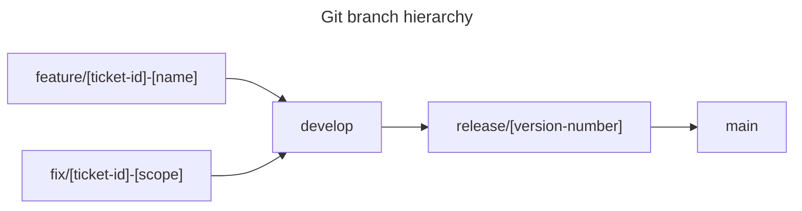

# Workflows

Choose a branching model that fits the team, then apply it the same way every time.

## Start with the smallest model that works

A workflow is a shared agreement about where work happens and how it reaches the main line. It exists to reduce confusion, not to add ceremony.

- A solo project can work directly on `main` with short-lived branches for experiments.
- A small team can use one shared main line and review every change.
- A team with scheduled releases may need a stabilization branch.

Adopt the simplest model that protects what you actually ship. Add branches when the risk justifies them, not because a diagram looks professional.

## A modified GitHub Flow

This model suits continuous delivery and small to medium teams. `main` is always deployable. Work happens on short branches and returns through a pull request.

| Branch | Purpose | Stability | Merge rule |
| --- | --- | --- | --- |
| `main` | Production code. Only code that has shipped and is live. Never write directly to it. | Stable | Merge from `release/*`, or a reviewed hotfix. |
| `develop` | Integration and testing. Features combine here before release. | Functional | Merge from `feature/*` after checks pass. |
| `feature/[ticket-id]-[name]` | New work in isolation. | Unstable, local | Merge into `develop` through a pull request. |
| `fix/[ticket-id]-[scope]` | A focused bug fix. | Unstable, local | Merge into `develop` through a pull request. |
| `release/[version]` | Stabilize a specific version before tagging. | Functional | Merge into `main` after end-to-end testing. |

## The merge protocol

1. Work on a `feature/` or `fix/` branch.
2. Let checks run on the branch.
3. Open a pull request into `develop`.
4. Review the change and test it.
5. Merge. Integration checks run.
6. When `develop` is stable, create `release/vX.Y.Z`.
7. Test the release branch. On success, merge to `main` and tag it.

## Branch names

Use a name that says what the branch does:

- `feature/#12-vendor-comparison`
- `fix/#18-login-timeout`
- `release/v0.3.0`

Include the ticket number when you have one. Avoid `my-branch`, `test`, or a person's name.

## Keep pull requests small

A review is only as good as what fits in a reviewer's head. Aim for one logical change per pull request.

- Split refactoring from behavior changes.
- Split formatting from logic.
- Link the issue the change closes.
- Describe how to test it.

Small pull requests merge faster and break less.

## Try it

Apply the workflow to `local-project/source/`.

1. Create a `feature/#1-first-change` branch from `main`.
2. Make one small commit and push the branch to a remote if you have one.
3. Merge it back into `main` locally, or open a pull request if you are using a hosted service.
4. Tag the result `v0.1.0`.
5. Write one sentence in your project notes explaining why you chose this model.

Next: [Undoing and hygiene](07-undoing-and-hygiene.md)
