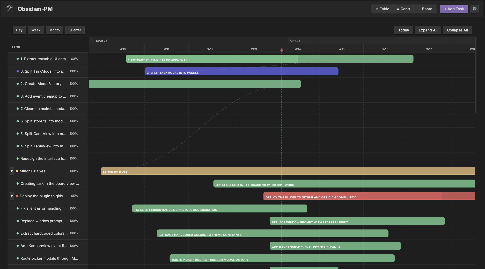
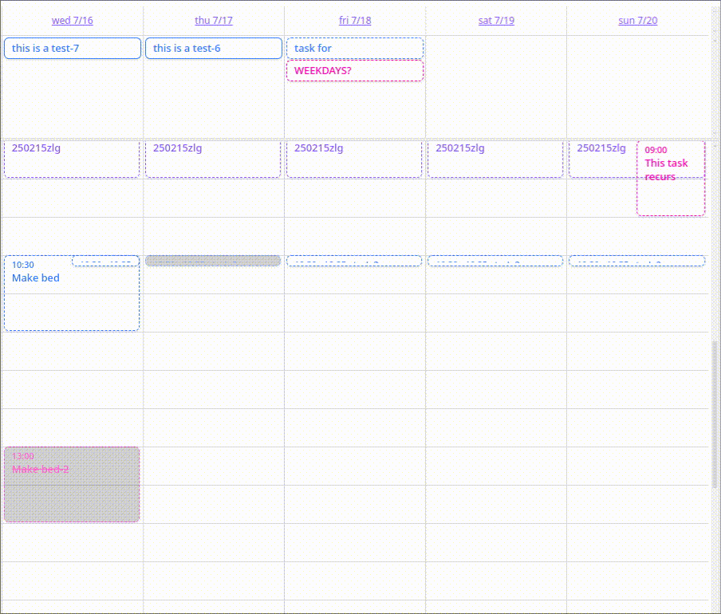

# Templates

Working templates for the skills in this repo. Each is optional.

- **[team-vault](team-vault/)** — shared team visibility using **dotpm**.
- **[personal-vault](personal-vault/)** — private task tracking using **TaskNotes**.
- **[project-workspace](project-workspace/README.md)** — the folder structure around them.

The team vault answers *what is the team doing and where does it stand?* The personal vault answers *what am I doing today?*

All templates are sanitized. They contain a generic `Example Project`, placeholder people, and no real project data.

---

## Quick start

To read the handbook itself in Obsidian, open the repo root folder as a vault. The vault templates below are separate vaults. New to Obsidian? See [Obsidian basics](../guides/obsidian/00-obsidian-basics.md).

Templates require Obsidian. The handbook itself does not.

| Team vault (dotpm) | Personal vault (TaskNotes) |
| --- | --- |
|  |  |

These are the plugins’ own demo screenshots, not this repo’s Example Project. Both projects are MIT licensed.

### 1. Open a vault

**Download only (no Git):** [download the handbook ZIP](https://github.com/openrodygu/project-engineering/archive/refs/heads/main.zip), extract it, and copy the template folder you want into a workspace folder. Then open the copy in Obsidian.

Copy `team-vault/` and/or `personal-vault/` into a workspace folder. Copy the whole folder, including the hidden `.obsidian` directory.

```text
local-project/
├── pm-vault/                   # copy of team-vault
└── personal-project-notes/     # copy of personal-vault
```

In Obsidian, choose **Open folder as vault** and select one of the copies.

### 2. Trust the vault

Trust the author and enable community plugins.

### 3. Open the README

- Team vault: open `_README.md`, then open **Example Project**.
- Personal vault: open `_README.md`, then work through `TaskNotes/Start Here.md`.

### 4. Adopt what fits

Change the project name, people, statuses, and tasks. Keep what helps. Remove what does not.

---

## Team vault

- dotpm is included and enabled.
- The project list opens from the **Project manager** pane.
- `Example Project` shows the project and task structure.
- The vault includes team-facing guides for Obsidian, dotpm, TaskNotes, and project management.

## Personal vault

- TaskNotes is included and enabled.
- Bases is enabled for the TaskNotes views.
- `TaskNotes/Start Here.md` is a guided tour.
- The vault includes personal guides for Obsidian, TaskNotes, shared-vault boundaries, and self-management.

## Project workspace

The workspace template is a README only. It shows a structure and explains why and how to adopt it. See [project-workspace/README.md](project-workspace/README.md).

---

## Requirements

- Obsidian **1.13 or newer** (dotpm requires 1.13; TaskNotes requires 1.12.2+).
- Desktop for setup. Template setup copies a hidden `.obsidian` folder; use a desktop file manager. Mobile can open a vault after it is set up.
- No accounts, databases, or external services.

---

## What is included

Each vault template includes:

- The Markdown guides.
- A small example project or task setup.
- Obsidian core plugin configuration.
- The required community plugin binaries and settings.
- The Border theme and theme configuration.

Each vault template excludes:

- `workspace.json`, so Obsidian creates a fresh layout for each user.
- Personal notes, real project data, and local paths.
- Any API tokens or credentials.

The vaults are not versioned by default. Versioning them is optional and up to you.

---

## Tested versions

| Component | Version |
| --- | --- |
| dotpm | 2.6.0 |
| TaskNotes | 4.16.1 |
| Border theme | 1.13.9 |

Newer plugin versions should work. If you update a plugin, let Obsidian manage the plugin folder.

---

## Customize

- Replace **Example Project** with your project name.
- Replace **Alice**, **Bob**, **Carol**, and **Dave** with your team.
- Update the project description, tasks, and dates.
- Adjust statuses and priorities in the plugin settings if needed.
- Keep the two-vault boundary: team commitments in the shared vault, personal execution in the personal vault.

See `team-vault/_README.md` and `personal-vault/_README.md` for the workflow rules.

---

## Attribution

This repo includes third-party Obsidian plugins and a theme. See [CREDITS.md](../CREDITS.md) for authors, versions, and links.

- dotpm — MIT licensed.
- TaskNotes — MIT licensed.
- Border theme — third-party theme by Akifyss; see the upstream repository for its license.

Obsidian itself is not included.

---

## License

The guides and templates in this repository are MIT licensed. See [LICENSE](../LICENSE).
